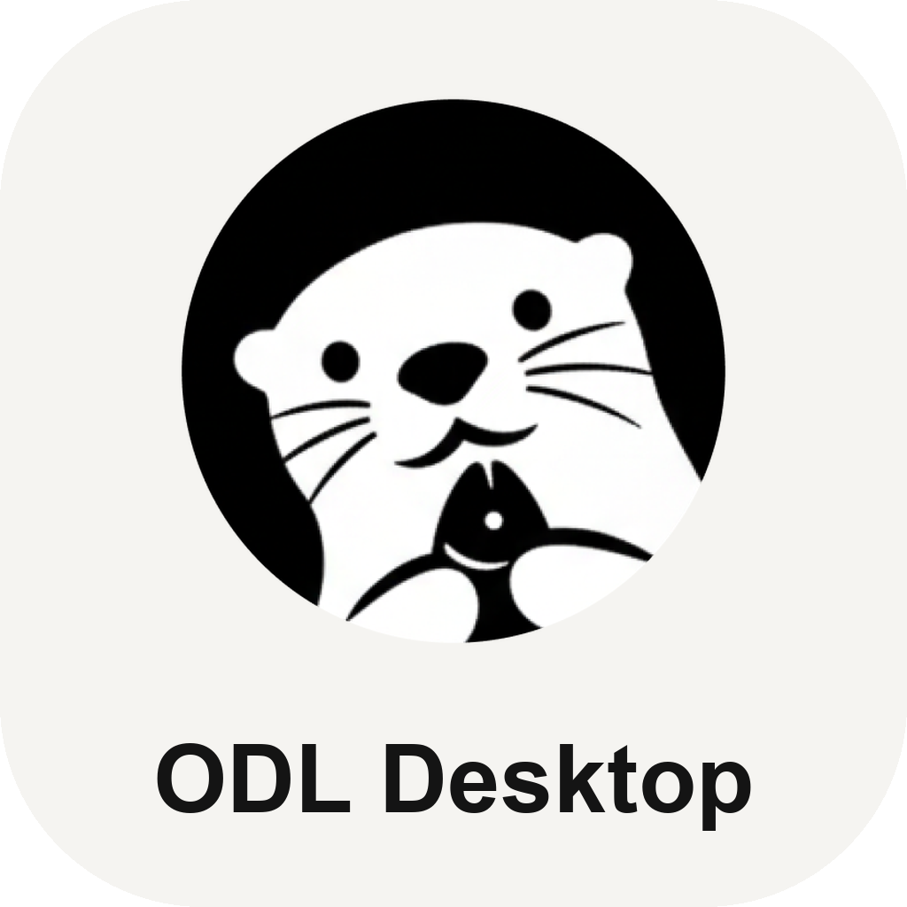

# ODL Desktop

A native macOS desktop app for [OpenDataLoader PDF](https://opendataloader.org) — pick files or a
folder, choose output formats, and convert, all from a window instead of a terminal. Built with
Python + [pywebview](https://pywebview.flowrl.com/), packaged as a double-clickable `.app` with
[py2app](https://py2app.readthedocs.io/).

## Features

- **Convert** PDFs to Markdown, JSON, HTML, or a tagged/accessibility PDF — batch a whole folder
  (optionally recursive), pick a page range, strip headers/footers, control table detection and
  reading order, extract or embed images, sanitize emails/phones/IPs/URLs out of the text.
- **Optional hybrid OCR backend** for scanned or image-heavy PDFs, with a language picker covering
  the 86 languages EasyOCR supports and adjustable formula/picture-description enrichment.
- **Settings persist** across launches (`~/Library/Application Support/ODL Desktop/prefs.json`).
- **In-app Java check** — the one thing the packaged app doesn't bundle. If Java's missing, a
  banner offers a direct download link and a one-click re-check, no relaunch needed.

## Download

Grab the latest build from the
[Releases page](https://github.com/wongchunhoi9/odl-desktop/releases) — unzip, then **right-click →
Open** the first time (it isn't notarized, so a plain double-click gets blocked by Gatekeeper).
That's it for the core conversion features; see [Hybrid/OCR setup](#hybridocr-setup) below if you
need OCR on scanned PDFs.

Current builds are **Apple Silicon (arm64) only** — see [Building the .app](#building-the-app) if
you need an Intel build.

### Requirements

- **macOS**, Apple Silicon.
- **Java 11+** — not bundled; the app detects this on launch and offers to help you install it.
  Everything else (the OpenDataLoader engine itself, included) ships inside the `.app`.

### Hybrid/OCR setup

The hybrid backend is a separate, optional install: `pip install "opendataloader-pdf[hybrid]"`
into any Python on your `PATH`, then start/stop it from the app's "Hybrid/OCR Backend" panel. Skip
this unless you're converting scanned PDFs — the panel explains what's missing if you try to start
it without that installed.

## Project layout

```
odl-desktop/
├── app.py                    # entry point — creates the pywebview window, wires the JS↔Python bridge
├── backend/
│   ├── api.py                 # the Api class exposed to the frontend (window.pywebview.api.*)
│   ├── converter.py           # wraps opendataloader_pdf.convert(); UI settings → CLI kwargs → results
│   ├── hybrid_server.py       # start/stop/health-check for the local hybrid/OCR backend process
│   ├── java_check.py          # verifies Java 11+ is on PATH before Convert is enabled
│   └── prefs.py               # persists last-used settings to ~/Library/Application Support
├── ui/
│   ├── index.html             # layout; titlebar links to the OpenDataLoader docs
│   ├── style.css
│   └── app.js                 # all frontend logic — no framework, no build step
├── assets/
│   ├── icon_1024.png          # source art for the app icon (original artwork, not OpenDataLoader's)
│   └── AppIcon.icns           # compiled icon, referenced by setup.py's OPTIONS["iconfile"]
├── requirements.txt
├── setup.py                  # py2app config for building the .app
├── LICENSE                   # MIT, this project's own code
├── THIRD_PARTY_NOTICES.md    # Apache-2.0 attribution for the bundled opendataloader-pdf dependency
├── THIRD_PARTY_LICENSE.txt   # full Apache 2.0 text, copied from opendataloader-pdf's own LICENSE
├── ROADMAP.md                # planned features, not yet implemented
└── README.md
```

## Development setup

```bash
git clone https://github.com/wongchunhoi9/odl-desktop.git
cd odl-desktop
python3 -m venv .venv
source .venv/bin/activate
pip install -r requirements.txt
python app.py
```

`requirements.txt` installs `pywebview` and `opendataloader-pdf[hybrid]` — the hybrid extra pulls
in `docling`/`torch`/OCR engines, so the first install takes a while and a few hundred MB. If you
only want the core conversion (no OCR), `pip install pywebview opendataloader-pdf` is enough; the
hybrid panel will just tell you the extra isn't installed if you try to use it.

## Building the .app

```bash
pip install py2app
python setup.py py2app
```

Output lands in `dist/ODL Desktop.app`, matching whatever architecture you build on (arm64 on
Apple Silicon, x86_64 on Intel — py2app doesn't cross-compile or produce universal binaries by
default). Since it isn't notarized, first launch needs a right-click → Open to get past Gatekeeper.

A couple of things `setup.py` does that are easy to break by "cleaning up":

- **`opendataloader_pdf` is under `includes`, not `packages`.** `packages` forces py2app to
  recursively bundle a package's entire submodule tree — including `hybrid_server.py`'s
  `docling`/`torch` imports, which this app never touches in-process (the hybrid backend runs as a
  separate OS subprocess via its own console script). That blows past Python's import-scan
  recursion limit and would bundle several GB of unused ML dependencies. `includes` makes py2app
  follow only what's actually imported (`wrapper.py`, `convert_generated.py`, etc.) — which, via
  `importlib.resources`, still picks up the package's ~24MB bundled Java CLI jar as data, extracted
  transparently from the zip at runtime. Verified by running a real conversion through the packaged
  app's embedded interpreter directly (`Contents/MacOS/python`, with `PYTHONHOME`/`PYTHONPATH`
  pointed at `Contents/Resources` so it resolves the bundle instead of falling back to the system
  Python).
- **`_find_conda_dylibs()` only matters if you build from a conda-based Python.** py2app's
  dependency scanner misses several `@rpath`-linked dylibs (`libffi`, `libssl`, `libcrypto`, etc.)
  that conda Python's stdlib C extensions need — without them the built app fails to launch with
  `Library not loaded: @rpath/lib*.dylib`. This function locates and bundles them explicitly. If it
  raises, your conda env is missing one of those libs under `<sys.base_prefix>/lib`; on a
  non-conda Python this code path isn't exercised.

## Creating a GitHub Release

To publish a build for others to download from the repo's Releases page:

```bash
# 1. Build the .app (see above), then zip it — GitHub Releases wants a file, not a raw .app bundle
cd dist && zip -r "ODL-Desktop-macOS-arm64.zip" "ODL Desktop.app" && cd ..

# 2. Tag the commit you're releasing
git tag v0.1.0
git push origin v0.1.0

# 3. Create the release and attach the zip
gh release create v0.1.0 "dist/ODL-Desktop-macOS-arm64.zip" \
  --title "v0.1.0" \
  --notes "First public build. Apple Silicon only — see README for Intel."
```

`gh release create` also works without a pre-existing tag (pass `--target main` and it creates the
tag for you). Bump the version in two places when cutting a real release: `setup.py`'s
`CFBundleShortVersionString` and the git tag should match. Since current builds are arm64-only,
say so in the release notes/asset name (as above) rather than implying it's universal.

## Licensing

ODL Desktop's own code is [MIT licensed](LICENSE).

It depends on and bundles [`opendataloader-pdf`](https://pypi.org/project/opendataloader-pdf/)
(Apache License 2.0, © Hancom, Inc.). Apache-2.0 permits using, depending on, and redistributing
that package — including inside this app's `.app` bundle — but **§6 (Trademarks)** explicitly does
*not* grant rights to OpenDataLoader's name, logo, or other marks. Concretely:

- Calling `opendataloader_pdf.convert()` from [converter.py](backend/converter.py) and shipping the
  package inside the packaged app: fine, covered by the license.
- Reusing OpenDataLoader's own logo or name as this app's branding: **not** covered — this app's
  icon is original artwork for that reason.
- [THIRD_PARTY_NOTICES.md](THIRD_PARTY_NOTICES.md) and
  [THIRD_PARTY_LICENSE.txt](THIRD_PARTY_LICENSE.txt) carry the required §4 attribution forward —
  `setup.py` bundles both into the packaged `.app`.

## Roadmap

See [ROADMAP.md](ROADMAP.md) for planned features (file-list thumbnails, single-page preview) —
not implemented yet.

## Notes / things left intentionally simple for now

- Conversion runs synchronously in a background thread per batch; there's no persistent job queue.
- Hybrid backend lifecycle is manual (you click Start/Stop) rather than auto-managed, so you
  always know whether a background process is alive.
- Settings persistence is a flat JSON file, not a real settings UI.
- `backend/hybrid_server.py` launches the hybrid backend via the `opendataloader-pdf-hybrid`
  console script installed by the `opendataloader-pdf[hybrid]` extra. If a future version of the
  package renames or changes that entry point, update `HYBRID_SERVER_EXECUTABLE` there.
- The OCR language picker (`ui/app.js`'s `EASYOCR_LANGUAGES`) is a hand-copied snapshot of
  `easyocr.config.all_lang_list` with human-readable names — it assumes the hybrid backend's
  default `--ocr-engine` (easyocr). Tesseract/RapidOCR/ocrmac use different code systems entirely
  (see `--ocr-engine`/`--ocr-lang` help in the installed `opendataloader-pdf[hybrid]` package); this
  app doesn't expose an engine picker, so switching engines would need this list swapped out too.
  Regenerate the list from `easyocr.config.all_lang_list` if the bundled easyocr version's language
  coverage changes.
- Same-named PDFs converted together (e.g. two `report.pdf` files from different subfolders with
  "Include subfolders" on) would silently overwrite each other's output, since the underlying CLI
  writes every input into one flat output folder named only by its stem. `run_conversion` detects
  this before converting and refuses the batch with a clear message rather than losing data.
